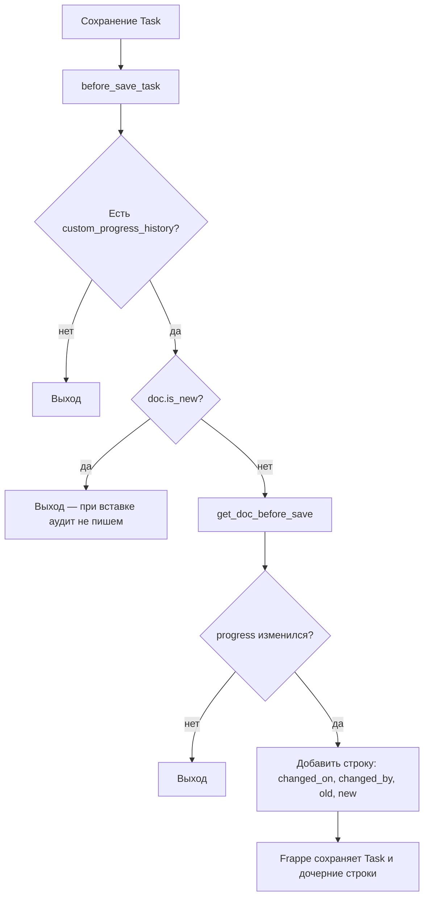

# Dinext Project Tasks Gantt

## 📖 Обзор

**Dinext Project Tasks Gantt** — приложение на [Frappe](https://frappeframework.com/), расширяющее ERPNext **Project / Task** для Dinext: представления Gantt и дерева, работа с зависимостями, оценки в story points и **журнал изменений поля «% выполнения»** (`progress`) у задач.

В составе приложения — **фикстуры** (Custom Field, Client Script, Server Script, записи Story Point) и **DocTypes** (например `Task Relation`, `Story Point`, `Task Progress History`). Серверная логика аудита прогресса вызывается при каждом сохранении `Task` через `doc_events`, поэтому изменения фиксируются при сохранении из формы, через API и в скриптах — не только из интерфейса Desk.

## ✨ Возможности

- **Расширение UI задачи** — Client Script на `Task` (дерево, Gantt, оформление и поведение зависимостей).
- **Логика зависимостей** — Server Script и дочерняя таблица **`Task Relation`** на `Task` (`custom_relations`) для связей предшественник/последователь и связанной автоматизации.
- **Story points** — DocType **`Story Point`** и поле-связь **`story_point`** на `Task`.
- **Аудит прогресса** — при сохранении уже существующей задачи, если **`progress`** реально изменился, в **`custom_progress_history`** (таблица **`Task Progress History`**) добавляется строка с `changed_on`, `changed_by`, `old_progress`, `new_progress`. При первой вставке документа строка не создаётся; при неизменном прогрессе дубликаты не пишутся.
- **Инструменты качества** — `pre-commit` с ruff, ESLint, Prettier, pyupgrade (см. `.pre-commit-config.yaml`).

## 🚀 Установка

Нужна рабочая среда [bench](https://github.com/frappe/bench) с уже установленным на целевом сайте **ERPNext** (и Frappe).

```bash
cd /path/to/frappe-bench
bench get-app https://github.com/YOUR_ORG/dinext_project_tasks_gantt.git --branch develop
bench --site your-site.local install-app dinext_project_tasks_gantt
bench --site your-site.local migrate
bench build --app dinext_project_tasks_gantt
```

После установки перезагрузите сайт и убедитесь, что **migrate** выполнился успешно, чтобы появились Custom Field и таблицы DocType.

## 🛠️ Использование

- **Desk** — откройте **Task** как обычно; блок **Progress History** отображается после поля **% Progress**, если кастомное поле есть. Строки заполняются автоматически; таблица только для чтения.
- **Разработчикам** — точка входа: `dinext_project_tasks_gantt.task_progress_audit.before_save_task` (регистрация в `hooks.py` в `doc_events["Task"]["before_save"]`). Константы и логика — в `dinext_project_tasks_gantt/task_progress_audit.py`.

Запуск тестов:

```bash
bench --site your-site.local run-tests --app dinext_project_tasks_gantt
```

## 📦 Технологии

- **Python** 3.10+ (см. `pyproject.toml`)
- **Frappe Framework** / **ERPNext** (через bench)
- **JavaScript** — Client Script (фикстуры) для Desk
- **Линтинг / форматирование** — Ruff, ESLint, Prettier, pyupgrade через pre-commit

## 🔧 Конфигурация

- **Hooks** — `dinext_project_tasks_gantt/hooks.py`: `app_name`, `fixtures` (Custom Field, Story Point, Client Script, Server Script), `doc_events` для аудита прогресса `Task`.
- **Фикстуры** — экспортированные метаданные в `dinext_project_tasks_gantt/fixtures/`. Новые Custom Field не добавляют правкой файлов вручную: создают в системе (или через MCP) и выполняют `bench export-fixtures` по принятому у команды процессу (см. `AGENTS.md`).
- **Патчи** — `dinext_project_tasks_gantt/patches.txt` для патчей миграций при необходимости.

## ✅ Требования

- [bench](https://github.com/frappe/bench) и сайт с установленным **ERPNext**
- **Python** >= 3.10
- **MariaDB** (или СУБД, поддерживаемая вашей версией Frappe), **Redis**, **Node** — как требует ваш стек bench

## 🤝 Участие в разработке

1. Клонируйте приложение в `apps/dinext_project_tasks_gantt`.
2. Установите pre-commit и включите его для репозитория:

```bash
cd apps/dinext_project_tasks_gantt
pre-commit install
```

3. Соблюдайте соглашения проекта в [`AGENTS.md`](AGENTS.md) (метаданные Frappe, фикстуры, правила MCP-first где применимо).

## 📄 Документация

- **[AGENTS.md](AGENTS.md)** — руководство по разработке в этом проекте (паттерны Frappe, DocType, фикстуры, тесты).
- **Frappe** — [документация Frappe](https://frappeframework.com/docs)
- **ERPNext** — [документация ERPNext](https://docs.erpnext.com)

## ❤️ Благодарности

Разработано **Dinext** для ERPNext/Frappe. Используются [Frappe Framework](https://frappeframework.com/) и [ERPNext](https://erpnext.com/).

## 📝 История изменений

Недавние коммиты (полная история — `git log`):

- Документация и навыки Cursor (AGENTS, инструменты для README).
- DocType Story Point и связанное поведение.
- Task Relation и фикстуры для зависимостей.
- Первичная инициализация приложения.

*Аудит прогресса (`Task Progress History`, `task_progress_audit`, тесты): см. текущую ветку и последние коммиты.*

## 🗂️ Структура репозитория

```text
dinext_project_tasks_gantt/          # Корень репозитория
├── README.md
├── license.txt
├── pyproject.toml                   # Метаданные пакета Python, ruff
├── .pre-commit-config.yaml
├── AGENTS.md                        # Руководство для контрибьюторов / Frappe
└── dinext_project_tasks_gantt/      # Основной Python-пакет
    ├── __init__.py
    ├── hooks.py                     # Фикстуры, doc_events (аудит прогресса Task)
    ├── task_progress_audit.py       # before_save: строки истории прогресса
    ├── modules.txt
    ├── patches.txt
    ├── fixtures/                    # JSON: Custom Field, Client/Server Script, Story Point
    ├── dinext_project_tasks_gantt/  # Модуль «Dinext Project Tasks Gantt»
    │   └── doctype/                 # JSON DocType, контроллеры, тесты
    │       ├── story_point/
    │       ├── task_relation/
    │       └── task_progress_history/
    ├── api/
    ├── config/
    ├── public/
    ├── templates/
    └── www/
```

- **`fixtures/`** — сериализованные метаданные Desk для установки/миграции; при `export-fixtures` источником истины остаётся целевой сайт.
- **`doctype/`** — DocType приложения (дочерняя таблица `Task Progress History`, `Task Relation`, `Story Point` и др.).
- **`task_progress_audit.py`** — серверный аудит при изменении `Task.progress`.

## 🔗 Схема потока

Упрощённая логика фиксации изменения прогресса:


