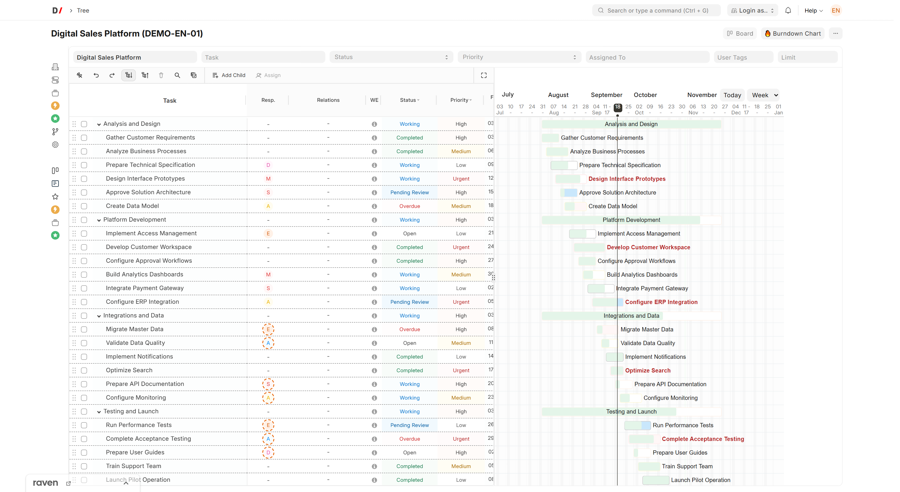
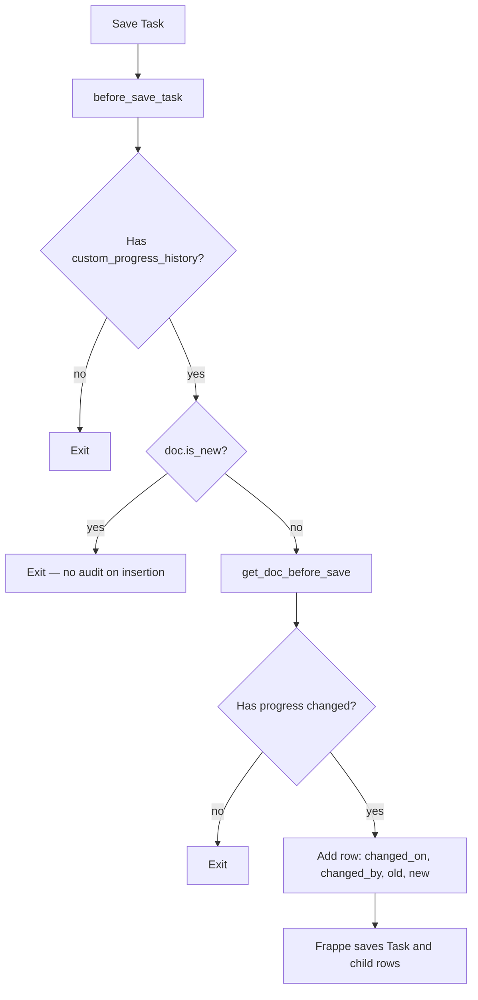
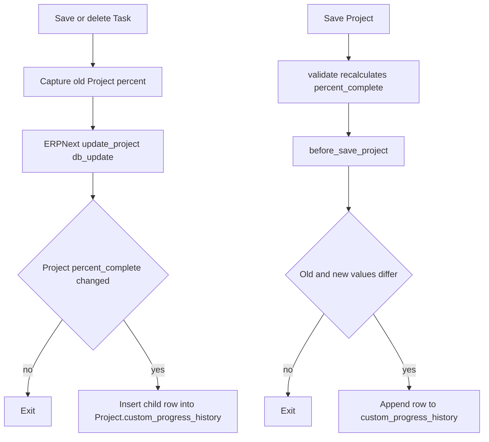
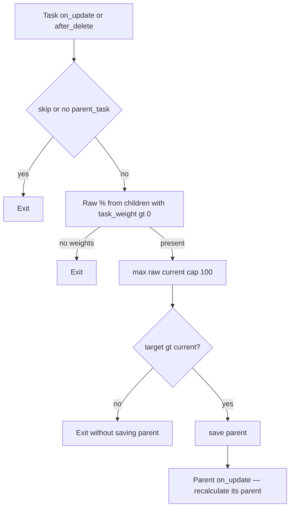
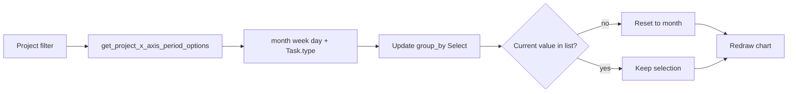
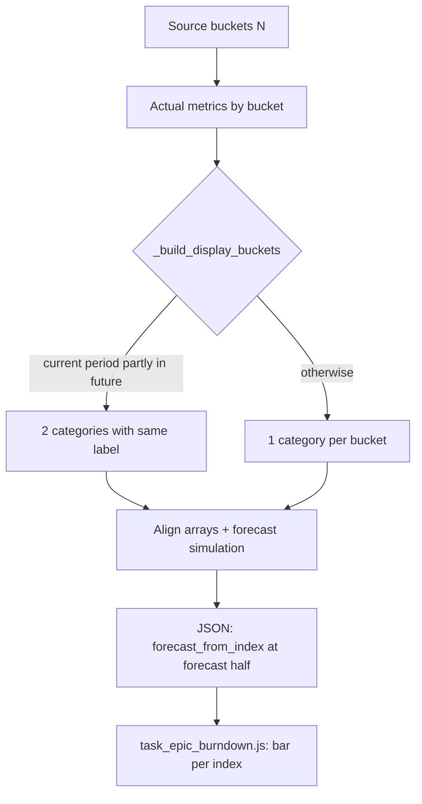

[Русский](README.ru.md)

<!-- dinext-presentation:start -->
<p align="center">
  <a href="https://dinext.ru"></a>
</p>
<h1 align="center">Dinext Project Tasks Gantt</h1>

<hr>

<p align="center">Plan project tasks in an interactive tree and Gantt chart with dependencies, dates and progress.</p>

<p align="center">
  
</p>
<p align="center"><sub>Task structure, dependencies and schedule on a demonstration Gantt chart.</sub></p>

<p align="center">
  <a href="https://dinext.ru">Website</a> · <a href="https://docs.dinext.ru">Documentation</a>
</p>
<!-- dinext-presentation:end -->

# Dinext Project Tasks Gantt

## 📖 Overview

**Dinext Project Tasks Gantt** is an application built on [Frappe](https://frappeframework.com/) that extends ERPNext **Project / Task** for Dinext: Gantt and tree views, dependency management, story point estimates, a **change log for task % complete** (`progress`) and project % complete (`percent_complete`), **automatic recalculation of group parents' `%`** using child task weights (with a monotonic floor and propagation up the hierarchy), and **chart series** (forecast/actual trends on the task form and the Epic Burndown report).

The application includes **fixtures** (Custom Field, Client Script, Server Script, Story Point records) and **DocTypes** (for example, `Task Relation`, `Story Point`, `Task Progress History`). Server logic for task progress auditing, project percentage auditing and group task rollup runs through `doc_events`, so changes are recorded when saving from a form, through the API and in scripts — not only from Desk. Both project scenarios are covered: direct `Project.save()` and the standard recalculation of `Project.percent_complete` from `Task`, where ERPNext saves the project through `db_update()`. Chart data is provided by [`burndown.py`](dinext_project_tasks_gantt/burndown.py) (whitelisted methods for the client and report).

## ✨ Features

- **Task UI extension** — Client Script on `Task` (tree, Gantt, dependency styling and behavior).
- **Dependency logic** — Server Script and the **`Task Relation`** child table on `Task` (`custom_relations`) for predecessor/successor relationships and related automation.
- **Story points** — the **`Story Point`** DocType and **`story_point`** Link field on `Task`.
- **Task progress auditing** — when an existing task is saved, if **`progress`** has actually changed, a row with `changed_on`, `changed_by`, `old_progress`, `new_progress` is added to **`custom_progress_history`** (the **`Task Progress History`** table). No row is created on initial document insertion; unchanged progress does not generate duplicate entries.
- **Project percentage auditing** — when **`Project.percent_complete`** changes, a row is also added to **`custom_progress_history`** on `Project`. Both paths are covered: direct project saving (`Project.before_save`) and percentage recalculation from tasks. For the task-driven scenario, the application captures the old project value in the `Task` lifecycle, compares it with the current value after the standard ERPNext recalculation, and inserts a child row directly without another `Project.save()`.
- **Group task progress (rollup)** — after saving or deleting a `Task`, **only the immediate** group parent is recalculated: a weighted average of immediate children with `task_weight > 0`; the result is **`max(raw, current %)`**, capped at 100%, so automation **does not lower** the parent's saved percentage. When the calculated value increases, the parent is saved with `save`, triggering the same mechanism for **its** parent (propagation without an explicit loop through all ancestors in a single hook). Disable with `doc.flags.skip_parent_progress_rollup = True`. Implementation: [`task_parent_progress.py`](dinext_project_tasks_gantt/task_parent_progress.py), `Task` events in [`hooks.py`](dinext_project_tasks_gantt/hooks.py) — `on_update`, `after_delete`.
- **Progress Trend on the Task form** — a form dashboard widget (connected through `hooks.py`: `doctype_js` for Task). Data: `dinext_project_tasks_gantt.burndown.get_task_progress_trend`; client: [`public/js/task_progress_trend.js`](dinext_project_tasks_gantt/public/js/task_progress_trend.js), styles: [`public/js/task_progress_trend_styles.js`](dinext_project_tasks_gantt/public/js/task_progress_trend_styles.js) (ECharts). Where possible, vertical date markers on the X axis match the corresponding series colors: **Today** — actual progress, **Progress forecast end** — progress forecast, **Work hours forecast end** — work hours forecast; when markers of different types share a bucket, a neutral theme color is used.
- **Task Epic Burndown report** — a Script Report in the application module; the chart is built from `get_burndown_series` (see `dinext_project_tasks_gantt/report/task_epic_burndown/`). Supported metrics are **hours**, **story points** and **task count**; the X axis uses **month**, **week**, **day**, or actual **group task** types in the selected project (`Task.type`, excluding **Issue**). The **X Axis Period** filter shows only types for which the project has at least one group task (`is_group=1`), for example **Sprint**, **Stage**, **Phase**, or another project-specific type. For task-type periods, the report interval is divided into **non-overlapping calendar segments**: a single period, overlaps of several periods (`Sprint 1 + Sprint 2`), and empty gaps outside any period (**Before …**, **Between … and …**, **After …**); burndown metrics are calculated for each segment's `[start, end]`. For **hours**, the waterfall segments are **Completed above expected → Completed → Released hours → Open → Created → Created+Completed**. **Completed above expected** shows hours logged beyond the task's planned volume in the period: cumulative approved task hours are compared with the plan, the portion within the plan goes into **Completed** / **Created+Completed**, and the overrun goes into **Completed above expected** (including tasks created in the same period). The plan may be set on a group task while actuals are collected from children. **Released hours** shows the difference between planned task volume and cumulative approved hours at completion; the completion date is the latest of `completed_on`, `act_end_date` and the date of the last approved timesheet with nonzero task hours. By default, the report table now displays a **detailed task list** using actual data from the current selection: **Period / Segment / Volume / Task**. Rows appear as soon as the report loads, do not duplicate the current period's forecast half, and use the task title as a link to the `Task` document in the **Task** column. The **completion forecast** (when forecast display is enabled) accounts for **different period lengths**: velocity and regression use calendar days, and future forecast volumes are scaled by each bucket's duration (including unequal custom stages). If the **current** period has not ended, the chart displays it **twice** with the same label: an actual portion (from the period start through today) and a forecast portion (the remaining days in that period); the forecast boundary (`forecast_from_index`) is placed at the second column. The report's **Reload / Refresh** button forces a new chart series request (bypassing deduplication with unchanged filters). Report and filter labels are localized through `translations/ru.csv`.
- **Quality tools** — `pre-commit` with ruff, ESLint, Prettier, pyupgrade (see `.pre-commit-config.yaml`).

## 🚀 Installation

A working [bench](https://github.com/frappe/bench) environment with **ERPNext** (and Frappe) already installed on the target site is required.

```bash
cd /path/to/frappe-bench
bench get-app https://github.com/YOUR_ORG/dinext_project_tasks_gantt.git --branch develop
bench --site your-site.local install-app dinext_project_tasks_gantt
bench --site your-site.local migrate
bench build --app dinext_project_tasks_gantt
```

After installation, reload the site and make sure **migrate** completed successfully so Custom Fields and DocType tables are created.

## 🛠️ Usage

- **Desk / Task** — open **Task** as usual; the **Progress History** block appears after **% Progress** if the custom field exists. Rows are populated automatically; the table is read-only. **Progress Trend** (for a task that is neither new nor a milestone) displays a chart by period (day / week / month). For **group** tasks, **% Progress** may update automatically when child tasks are saved or deleted, following the rollup rules (see Features).
- **Desk / Project** — if `Project` has `custom_progress_history`, the history table is also populated automatically when **`percent_complete`** changes. This works both for manually saved projects and task changes that recalculate the project percentage in ERPNext.
- **Task Epic Burndown** — open the report in Desk and select a project, period and metric. **X Axis Period** lets you choose calendar grouping or one of the current project's **group task** types (`Task.type`, excluding **Issue**). The list is dynamic: if the project has group tasks of types **Sprint** and **Release**, those are the types the filter shows; if there are no such tasks, only **month / week / day** remain. When switching projects, if the previously selected period type is unavailable in the new project, the filter resets to **month**. For task-type periods, the X axis is built from tasks of the selected type and dates in `exp_*` / `custom_planned_*`, covering the entire report range, including overlaps and gaps without a period. For **hours**, each period column comprises: **Completed above expected** (hours beyond the task plan in the period, displayed above **Completed**), completed hours within the plan (approved timesheets in the period), **Released hours** (unused planned volume at the task's completion date), open volume at the period end, created volume, and volume created+completed within that period. The table below the chart immediately shows a **detailed task list** using only actual data from the filtered selection; forecast buckets are excluded. The **Task** column shows the task title as a link to the `Task` document. When the completion forecast is enabled, an unfinished **current** period may appear **twice** consecutively on the X axis (with the same label): first the actual column, then that period's forecast portion; the vertical forecast boundary is between them. Clicking **Completed** / **Completed above expected** / **Created+Completed** segments in hours mode opens a **User Timesheet Position** list; clicking **Released hours** and other segments opens a **Task** list (forecast columns are not clickable). Explicit report refresh (the Reload icon or **Refresh** item) redraws the chart even when filters have not changed.
- **For developers** — task auditing: `dinext_project_tasks_gantt.task_progress_audit.before_save_task` (`doc_events["Task"]["before_save"]`). Project auditing: `dinext_project_tasks_gantt.project_progress_audit.before_save_project`, `before_insert_task`, `before_save_task`, `on_trash_task`, `on_update_task`, `after_delete_task`. Parent rollup: `dinext_project_tasks_gantt.task_parent_progress.on_update_task` and `after_delete_task`. Task audit logic: `task_progress_audit.py`; project audit logic: `project_progress_audit.py`; rollup: [`task_parent_progress.py`](dinext_project_tasks_gantt/task_parent_progress.py). Burndown and trend: `burndown.py` (`get_burndown_series`, `get_project_x_axis_period_options`, `get_period_buckets`, `_build_display_buckets`, `_bucket_duration_days` / `_bucket_remaining_days`, `_forecast_bucket_range`, `_hours_completion_date`, `_utp_max_date_by_task`); the `group_by` filter value for task-type periods is the exact `Task.type` name (for example, `Sprint`, `Release`), not a lowercase key. Report payload: parallel arrays aligned with `categories`; for a partially elapsed current period, the backend duplicates the label at two adjacent indexes, and `forecast_from_index` points to the forecast half. Report client: [`task_epic_burndown.js`](dinext_project_tasks_gantt/dinext_project_tasks_gantt/report/task_epic_burndown/task_epic_burndown.js) (one bar per category index, `idx >= forecast_from_index` → forecast series; dynamic **X Axis Period** updates when switching projects). Tests: `test_burndown.py`, [`test_task_parent_progress.py`](dinext_project_tasks_gantt/test_task_parent_progress.py), `doctype/task_progress_history/test_task_progress_history.py`.

Running tests:

```bash
bench --site your-site.local run-tests --app dinext_project_tasks_gantt
bench --site your-site.local run-tests --app dinext_project_tasks_gantt --module dinext_project_tasks_gantt.test_task_parent_progress
bench --site your-site.local run-tests --app dinext_project_tasks_gantt --module dinext_project_tasks_gantt.test_burndown
bench --site your-site.local run-tests --app dinext_project_tasks_gantt --module dinext_project_tasks_gantt.dinext_project_tasks_gantt.doctype.task_progress_history.test_task_progress_history
```

## 📦 Technologies

- **Python** 3.10+ (see `pyproject.toml`)
- **Frappe Framework** / **ERPNext** (through bench)
- **JavaScript** — Client Script (fixtures) for Desk
- **Linting / formatting** — Ruff, ESLint, Prettier, pyupgrade through pre-commit

## 🔧 Configuration

- **Hooks** — `dinext_project_tasks_gantt/hooks.py`: `app_name`, `fixtures` (Custom Field, Story Point, Client Script, Server Script), `doc_events` for `Project` and `Task`: `Project.before_save` for direct auditing of `percent_complete`; `Task.before_insert` / `before_save` / `on_trash` for capturing the old project percentage; `Task.on_update` / `after_delete` for recording project history after the ERPNext recalculation; the existing `Task.before_save` (auditing `progress`) and `Task.on_update` / `after_delete` (rolling up `%` to the immediate group parent) remain in place alongside these hooks.
- **Fixtures** — exported metadata in `dinext_project_tasks_gantt/fixtures/`. New Custom Fields are not added by editing files manually: create them in the system (or through MCP) and run `bench export-fixtures` according to the team's process (see `AGENTS.md`).
- **Patches** — `dinext_project_tasks_gantt/patches.txt` for migration patches when necessary.

## ✅ Requirements

- [bench](https://github.com/frappe/bench) and a site with **ERPNext** installed
- **Python** >= 3.10
- **MariaDB** (or a DBMS supported by your Frappe version), **Redis**, **Node** — as required by your bench stack

## 🤝 Contributing

1. Clone the application into `apps/dinext_project_tasks_gantt`.
2. Install pre-commit and enable it for the repository:

```bash
cd apps/dinext_project_tasks_gantt
pre-commit install
```

3. Follow the project conventions in [`AGENTS.md`](AGENTS.md) (Frappe metadata, fixtures, MCP-first rules where applicable).

## 📄 Documentation

- **[AGENTS.md](AGENTS.md)** — this project's development guide (Frappe patterns, DocTypes, fixtures, tests).
- **Frappe** — [Frappe documentation](https://frappeframework.com/docs)
- **ERPNext** — [ERPNext documentation](https://docs.erpnext.com)

## 📝 Changelog

Recent commits (full history: `git log`):

- Task Epic Burndown: completion forecasting that accounts for **unequal period lengths** (velocity and regression based on calendar days, forecast volumes scaled by bucket duration).
- Task Epic Burndown: **two columns** for an unfinished current period (actual + forecast portions of the same label); `forecast_from_index` at the forecast half; `_build_display_buckets` in `burndown.py`.
- Task Epic Burndown: dynamic **X Axis Period** filter — `get_project_x_axis_period_options` and Select updates when switching projects; the list contains only **month / week / day** plus project group task types (`is_group=1`, excluding **Issue**); `group_by` for a period is set to the `Task.type` name; unavailable values reset to **month**.
- Task Epic Burndown: X axis by task type — full segmentation of the report range (single periods, `A + B` overlaps, empty **Before / Between / After** intervals); metric calculation over non-overlapping `[start, end]`; tests in `test_burndown.py`.
- Task Epic Burndown: forced chart refresh on **Reload / Refresh** (bypassing client-side deduplication with unchanged filters).
- Task Epic Burndown (hours): the **Completed above expected** / «Завершено сверх прогноза» segment above **Completed** when task volume exceeds the plan (including tasks created in the same period; group task plans and child task actuals are accounted for); drilldown into **User Timesheet Position**.
- Task Epic Burndown (hours): the **Released hours** / «Высвобожденные часы» segment between Completed and Open; calculation at the completion date `max(completed_on, act_end_date, last approved timesheet)`; translation in `translations/ru.csv`.
- Cascading `%` recalculation for group `Task` records using child weights (`task_parent_progress`, `on_update` / `after_delete` hooks, `test_task_parent_progress` tests).
- Progress Trend widget on Task: `get_task_progress_trend` API, date markers aligned with series colors (when a bucket has a single marker type).
- `Project.percent_complete` auditing: history in `Project.custom_progress_history` both for direct `Project.save()` and project recalculation from `Task` through `db_update()`; tests in `doctype/task_progress_history/test_task_progress_history.py`.
- Documentation and Cursor skills (AGENTS, README tools).
- Story Point DocType and related behavior.
- Task Relation and dependency fixtures.
- Initial application initialization.

*For progress auditing, group rollup and burndown, see the current branch and `git log`.*

## 🗂️ Repository Structure

```text
dinext_project_tasks_gantt/          # Repository root
├── README.md
├── license.txt
├── pyproject.toml                   # Python package metadata, ruff
├── .pre-commit-config.yaml
├── AGENTS.md                        # Contributor / Frappe guide
└── dinext_project_tasks_gantt/      # Main Python package
    ├── __init__.py
    ├── hooks.py                     # Fixtures, Project/Task doc_events (audit, rollup)
    ├── task_progress_audit.py       # before_save: task progress history rows
    ├── project_progress_audit.py    # Project percent_complete audit on save and task-driven recalculation
    ├── task_parent_progress.py      # on_update / after_delete: weighted group rollup, monotonicity
    ├── burndown.py                  # get_task_progress_trend, get_burndown_series, series calculation
    ├── test_burndown.py
    ├── test_task_parent_progress.py # Group task progress rollup tests
    ├── modules.txt
    ├── patches.txt
    ├── fixtures/                    # JSON: Custom Field, Client/Server Script, Story Point
    ├── dinext_project_tasks_gantt/  # Dinext Project Tasks Gantt module
    │   ├── doctype/                 # DocType JSON, controllers, tests
    │   │   ├── story_point/
    │   │   ├── task_relation/
    │   │   └── task_progress_history/
    │   └── report/                  # Task Epic Burndown Script Report (+ chart JS)
    │       └── task_epic_burndown/
    ├── api/
    ├── config/
    ├── public/                      # JS assets (for example js/task_progress_trend.js, js/task_progress_trend_styles.js)
    ├── templates/
    └── www/
```

- **`fixtures/`** — serialized Desk metadata for installation/migration; the target site remains the source of truth for `export-fixtures`.
- **`doctype/`** — application DocTypes (the `Task Progress History` child table, `Task Relation`, `Story Point`, etc.).
- **`task_progress_audit.py`** — server-side auditing when `Task.progress` changes.
- **`project_progress_audit.py`** — server-side auditing when `Project.percent_complete` changes, including project recalculation from `Task`.
- **`task_parent_progress.py`** — recalculation of the immediate group parent's `%` from child weights (monotonic floor).
- **`burndown.py`** — series calculation for the Progress Trend widget and Epic Burndown report: `get_project_x_axis_period_options`, `get_period_buckets` / `iter_task_type_period_buckets_from_rows` (X axis by any `Task.type`), `get_burndown_series`, `_period_volume_burndown` (actual + completion forecast), `_build_display_buckets` (splitting the current period into actual/forecast portions for the chart), duration-aware forecasting (`_bucket_duration_days`, `_forecast_bucket_range`, `_velocity_window_daily_rates`), `completed_above_expected`, `unused_hours` / Released hours for hours mode.
- **`translations/ru.csv`** — Russian report label translations, including **Completed above expected** → «Завершено сверх прогноза» and **Released hours** → «Высвобожденные часы».

## 🔗 Flow Diagram

### Auditing changes to `progress`



### Auditing changes to `Project.percent_complete`



### Group parent progress rollup

After a task is successfully saved or deleted (unless `skip_parent_progress_rollup` is set):



### Dynamic X Axis Period filter (Task Epic Burndown)

When the project changes, the client requests X axis options; the server returns calendar periods and distinct `Task.type` values for the project's group tasks.



### Completion forecast and current-period split (Task Epic Burndown)

Source buckets are calculated over calendar `[start, end]` intervals. For the chart payload, `_build_display_buckets` may split the **current** bucket into two display entries with the same label: actual (through today) and forecast (remaining days). The `categories`, `open`, `completed`, `forecast_*` arrays are aligned by display index; `forecast_from_index` points to the forecast half.


