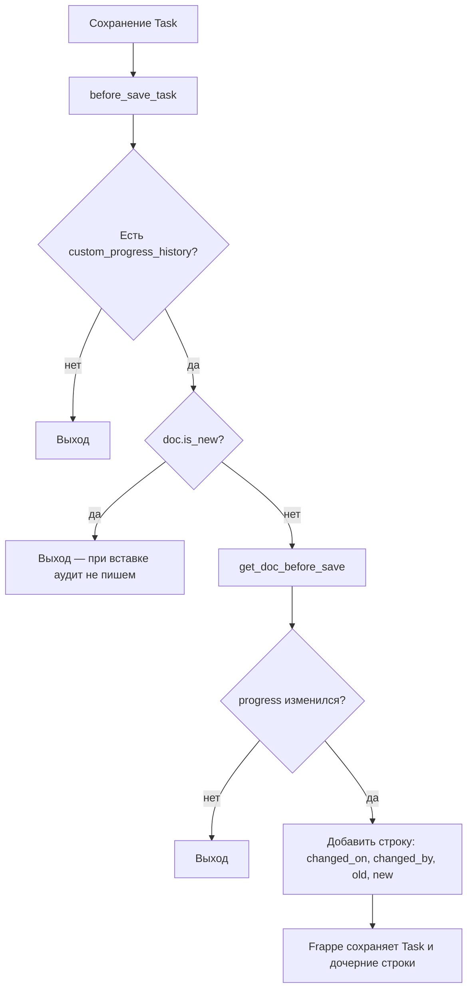
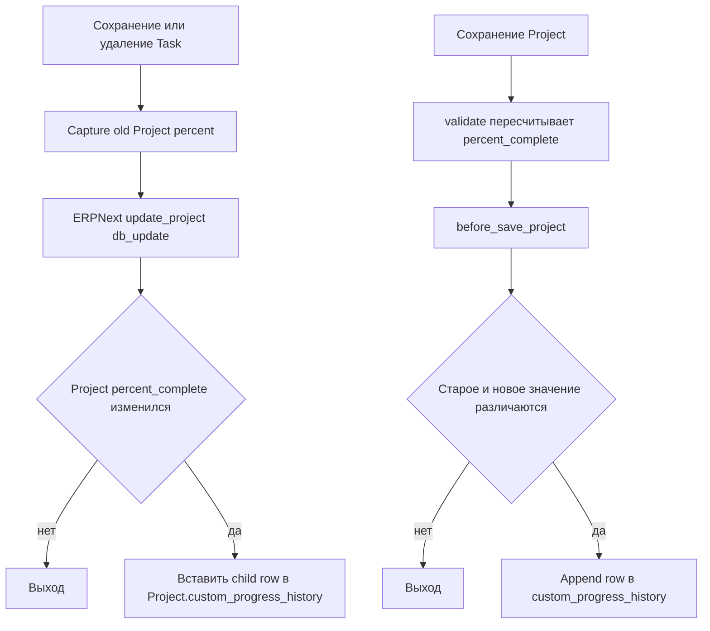
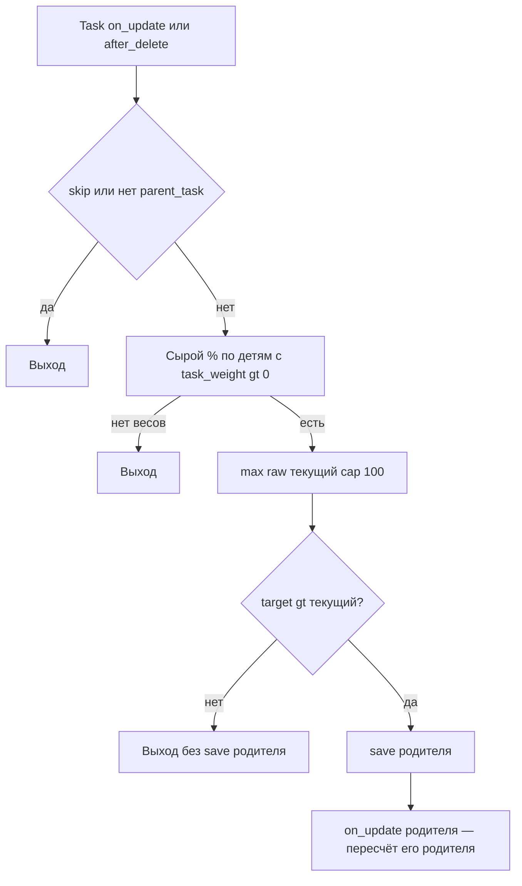
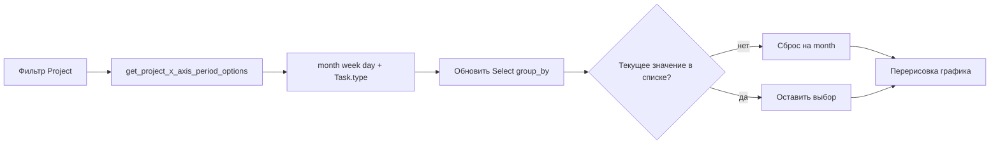
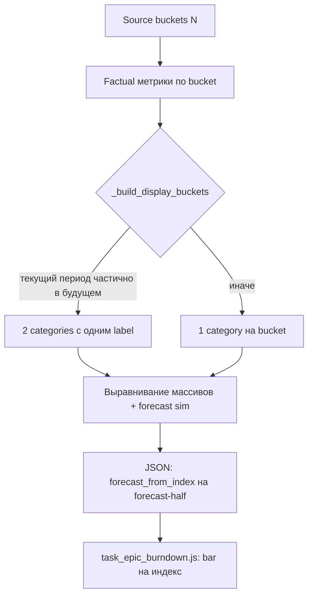

[English](README.md)

<!-- dinext-presentation:start -->
<p align="center">
  <a href="https://dinext.ru"></a>
</p>
<h1 align="center">Dinext Project Tasks Gantt</h1>

<hr>

<p align="center">Планирование задач проекта в интерактивном дереве и диаграмме Ганта со связями, сроками и прогрессом.</p>

<p align="center">
  
</p>
<p align="center"><sub>Структура задач, зависимости и сроки на демонстрационной диаграмме Ганта.</sub></p>

<p align="center">
  <a href="https://dinext.ru">Сайт</a> · <a href="https://docs.dinext.ru">Документация</a>
</p>
<!-- dinext-presentation:end -->

# Dinext Project Tasks Gantt

## 📖 Обзор

**Dinext Project Tasks Gantt** — приложение на [Frappe](https://frappeframework.com/), расширяющее ERPNext **Project / Task** для Dinext: представления Gantt и дерева, работа с зависимостями, оценки в story points, **журнал изменений поля «% выполнения»** у задач (`progress`) и проектов (`percent_complete`), **автоматический пересчёт `%` у групповых родителей** по весам дочерних задач (с монотонным «полом» и цепочкой вверх по иерархии), а также **серии для графиков** (тренд прогноза/факта на форме задачи и отчёт Epic Burndown).

В дереве задач и на диаграмме Гантта можно включить **критический путь** по текущим плановым датам (`exp_start_date` / `exp_end_date`) и активным строкам `Task Relation`. Даты не переносятся: подсветка показывает, какие задачи и связи держат финиш проекта.

В составе приложения — **фикстуры** (Custom Field, Client Script, Server Script, записи Story Point) и **DocTypes** (например `Task Relation`, `Story Point`, `Task Progress History`). Серверная логика аудита прогресса задач, аудита процента проекта и rollup групповых задач вызывается через `doc_events`, поэтому изменения фиксируются при сохранении из формы, через API и в скриптах — не только из интерфейса Desk. Для проекта покрываются оба сценария: прямой `Project.save()` и штатный пересчёт `Project.percent_complete` из `Task`, где ERPNext сохраняет проект через `db_update()`. Данные для графиков отдаёт модуль [`burndown.py`](dinext_project_tasks_gantt/burndown.py) (whitelisted-методы для клиента и отчёта).

## ✨ Возможности

- **Расширение UI задачи** — Client Script на `Task` (дерево, Gantt, оформление и поведение зависимостей).
- **Логика зависимостей** — Server Script и дочерняя таблица **`Task Relation`** на `Task` (`custom_relations`) для связей предшественник/последователь и связанной автоматизации.
- **Критический путь** — полный резерв по плановым датам и активным связям `Task Relation` (FS / SS / FF / SF, лаг `buffer_days`). Рабочие дни пропускают субботу, воскресенье и Holiday List проекта, иначе список компании. Узел — любая читаемая задача проекта, кроме `Cancelled` и задач без обеих плановых дат; групповая задача считается по своим `exp_*`, а не потому что критичен ребёнок. Выполненные задачи входят в путь плана. Цикл в связях из расчёта исключается. Подсветка строк дерева, баров и стрелок включается чекбоксом с иконкой в тулбаре таблицы (по умолчанию выключен, состояние на пользователя). Реализация: [`task_tree_gantt/critical_path.py`](dinext_project_tasks_gantt/task_tree_gantt/critical_path.py), whitelist `dinext_project_tasks_gantt.api.get_critical_path`.
- **Story points** — DocType **`Story Point`** и поле-связь **`story_point`** на `Task`.
- **Аудит прогресса задачи** — при сохранении уже существующей задачи, если **`progress`** реально изменился, в **`custom_progress_history`** (таблица **`Task Progress History`**) добавляется строка с `changed_on`, `changed_by`, `old_progress`, `new_progress`. При первой вставке документа строка не создаётся; при неизменном прогрессе дубликаты не пишутся.
- **Аудит процента проекта** — при изменении **`Project.percent_complete`** строка также добавляется в **`custom_progress_history`** на `Project`. Покрываются оба пути: прямое сохранение проекта (`Project.before_save`) и пересчёт процента из задач. Для task-driven сценария приложение заранее запоминает старое значение проекта в lifecycle `Task`, а после штатного ERPNext-пересчёта сравнивает его с текущим и добавляет child-row напрямую, без повторного `Project.save()`.
- **Прогресс групповых задач (rollup)** — после сохранения или удаления `Task` пересчитывается **только прямой** родитель-группа: взвешенное среднее по прямым детям с `task_weight > 0`; итог **`max(raw, текущий %)`** и не выше 100%, то есть сохранённый у родителя процент **не понижается** автоматикой; при росте расчётного значения выполняется `save` родителя, что запускает тот же механизм для **его** родителя (цепочка без явного цикла по всем предкам в одном хуке). Отключение: `doc.flags.skip_parent_progress_rollup = True`. Реализация: [`task_parent_progress.py`](dinext_project_tasks_gantt/task_parent_progress.py), события `Task` в [`hooks.py`](dinext_project_tasks_gantt/hooks.py) — `on_update`, `after_delete`.
- **Progress Trend на форме Task** — виджет в дашборде формы (подключается через `hooks.py`: `doctype_js` для Task). Данные: `dinext_project_tasks_gantt.burndown.get_task_progress_trend`; клиент: [`public/js/task_progress_trend.js`](dinext_project_tasks_gantt/public/js/task_progress_trend.js), стили: [`public/js/task_progress_trend_styles.js`](dinext_project_tasks_gantt/public/js/task_progress_trend_styles.js) (ECharts). Вертикальные маркеры дат на оси X по возможности совпадают по цвету с соответствующими линиями рядов: **Today** — фактический прогресс, **Progress forecast end** — прогноз прогресса, **Work hours forecast end** — прогноз трудозатрат; если в одном bucket объединены маркеры разных типов, используется нейтральный цвет темы.
- **Отчёт Task Epic Burndown** — Script Report в модуле приложения; график строится из `get_burndown_series` (см. `dinext_project_tasks_gantt/report/task_epic_burndown/`). Поддерживаются показатели **hours**, **story points** и **task count**; ось X — **month**, **week**, **day** или привязка к реальным типам **групповых задач** выбранного проекта (`Task.type`, кроме **Issue**). Фильтр **X Axis Period** показывает только те типы, для которых в проекте есть хотя бы одна групповая задача (`is_group=1`), например **Sprint**, **Stage**, **Phase** или другой проектный тип. Для task-type периодов интервал отчёта разбивается на **непересекающиеся календарные сегменты**: одиночный период, пересечение нескольких (`Sprint 1 + Sprint 2`) и «пустые» промежутки вне любого периода (**Before …**, **Between … and …**, **After …**); метрики burndown считаются по `[start, end]` каждого сегмента. Для **hours** — waterfall-сегменты **Completed above expected → Completed → Released hours → Open → Created → Created+Completed**. Сегмент **Completed above expected** («Завершено сверх прогноза») показывает часы, залогированные сверх планового объёма задачи в периоде: накопленные согласованные часы по задаче сравниваются с планом, и часть в пределах плана попадает в **Completed** / **Created+Completed**, а перерасход — в **Completed above expected** (в том числе для задач, созданных в том же периоде). План может быть задан на групповой задаче, а факт — собираться по дочерним. Сегмент **Released hours** («Высвобожденные часы») показывает разницу между плановым объёмом задачи и накопленными согласованными часами на дату завершения; дата завершения — наибольшая из `completed_on`, `act_end_date` и даты последнего согласованного ТШ с ненулевыми часами по задаче. Табличная часть отчёта теперь по умолчанию показывает **детальный список задач** по фактическим данным текущей выборки: **Period / Segment / Volume / Task**. Строки появляются сразу при загрузке отчёта, не дублируют forecast-half текущего периода и для колонки **Task** используют название задачи как ссылку на документ `Task`. **Прогноз завершения** (при включённом показе forecast) учитывает **разную длительность** периодов: скорость и регрессия считаются по календарным дням, а будущие прогнозные объёмы масштабируются длительностью каждого bucket (в том числе для неравных кастомных этапов). Если **текущий** период ещё не закончился, на графике он отображается **дважды** с одним label: factual-часть (от начала периода до today) и forecast-часть (оставшиеся дни того же периода); граница прогноза (`forecast_from_index`) ставится на второй столбец. Кнопка **Reload / Refresh** отчёта принудительно перезапрашивает серию графика (обход dedupe при тех же фильтрах). Подписи отчёта и фильтров локализуются через `translations/ru.csv`.
- **Инструменты качества** — `pre-commit` с ruff, ESLint, Prettier, pyupgrade (см. `.pre-commit-config.yaml`).

## 🚀 Установка

Нужна рабочая среда [bench](https://github.com/frappe/bench) с уже установленным на целевом сайте **ERPNext** (и Frappe).

```bash
cd /path/to/frappe-bench
bench get-app https://github.com/YOUR_ORG/dinext_project_tasks_gantt.git --branch develop
bench --site your-site.local install-app dinext_project_tasks_gantt
bench --site your-site.local migrate
bench build --app dinext_project_tasks_gantt
```

После установки перезагрузите сайт и убедитесь, что **migrate** выполнился успешно, чтобы появились Custom Field и таблицы DocType.

## 🛠️ Использование

- **Дерево задач / Гантт** — на странице дерева (`/app/tree/Task`) чекбокс с иконкой цепочки рядом с «Факт» и «План» включает критический путь выбранного проекта. Пока он выключен, запроса нет и подсветки нет. Пока включён, критические строка, бар и стрелка помечены; смена дат, связей или статуса пересчитывает путь.
- **Desk / Task** — откройте **Task** как обычно; блок **Progress History** отображается после поля **% Progress**, если кастомное поле есть. Строки заполняются автоматически; таблица только для чтения. Секция **Progress Trend** (если задача не новая и не milestone) показывает график по периоду (день / неделя / месяц). У **групповых** задач поле **% Progress** при сохранении или удалении дочерних задач может обновиться автоматически по правилам rollup (см. раздел «Возможности»).
- **Desk / Project** — если на `Project` присутствует `custom_progress_history`, таблица истории также заполняется автоматически при изменении **`percent_complete`**. Это работает и при ручном сохранении проекта, и при изменениях задач, которые пересчитывают процент проекта в ERPNext.
- **Task Epic Burndown** — откройте отчёт в Desk, выберите проект, период и показатель. В фильтре **X Axis Period** можно выбрать календарную группировку или один из типов **групповых задач** текущего проекта (`Task.type`, кроме **Issue**). Список динамический: если в проекте есть групповые задачи типов **Sprint** и **Release**, фильтр покажет именно их; если таких задач нет, останутся только **month / week / day**. При смене проекта, если ранее выбранный тип периода в новом проекте недоступен, фильтр сбрасывается на **month**. Для task-type периодов ось X строится по задачам выбранного типа и датам из `exp_*` / `custom_planned_*`, с полным покрытием диапазона отчёта, включая пересечения и промежутки без периода. Для **hours** столбец периода складывается из сегментов: **завершено сверх прогноза** (часы сверх плана задачи в периоде, отображаются над **Completed**), завершённые часы в пределах плана (согласованные ТШ в периоде), **высвобождённые часы** (неиспользованный плановый объём на дату завершения задачи), открытый объём на конец периода, созданный объём и созданный+завершённый в том же периоде. Табличная часть под графиком сразу показывает **детальный список задач** только по фактическим данным отфильтрованной выборки; прогнозные bucket'ы в неё не попадают. В колонке **Task** отображается название задачи как ссылка с переходом в документ `Task`. При включённом прогнозе завершения незавершённый **текущий** период может появиться на оси X **дважды** подряд (одинаковая подпись): сначала factual-столбец, затем прогнозная часть того же периода; вертикальная граница прогноза проходит между ними. Клик по сегментам **Completed** / **Completed above expected** / **Created+Completed** в режиме hours открывает список **User Timesheet Position**; по **Released hours** и остальным сегментам — список **Task** (прогнозные столбцы не кликабельны). Явное обновление отчёта (иконка Reload или пункт **Refresh**) перерисовывает график даже без смены фильтров.
- **Разработчикам** — аудит задачи: `dinext_project_tasks_gantt.task_progress_audit.before_save_task` (`doc_events["Task"]["before_save"]`). Аудит проекта: `dinext_project_tasks_gantt.project_progress_audit.before_save_project`, `before_insert_task`, `before_save_task`, `on_trash_task`, `on_update_task`, `after_delete_task`. Rollup родителя: `dinext_project_tasks_gantt.task_parent_progress.on_update_task` и `after_delete_task`. Логика аудита задачи — `task_progress_audit.py`; логика аудита проекта — `project_progress_audit.py`; rollup — [`task_parent_progress.py`](dinext_project_tasks_gantt/task_parent_progress.py). Burndown и тренд — `burndown.py` (`get_burndown_series`, `get_project_x_axis_period_options`, `get_period_buckets`, `_build_display_buckets`, `_bucket_duration_days` / `_bucket_remaining_days`, `_forecast_bucket_range`, `_hours_completion_date`, `_utp_max_date_by_task`); значение фильтра `group_by` для task-type периодов — точное имя `Task.type` (например `Sprint`, `Release`), не lowercase-ключи. Payload отчёта: параллельные массивы по `categories`; при частично текущем периоде backend дублирует label в двух соседних индексах, `forecast_from_index` указывает на forecast-half. Клиент отчёта — [`task_epic_burndown.js`](dinext_project_tasks_gantt/dinext_project_tasks_gantt/report/task_epic_burndown/task_epic_burndown.js) (один bar на индекс категории, `idx >= forecast_from_index` → forecast-серии; динамическое обновление **X Axis Period** при смене проекта). Тесты — `test_burndown.py`, [`test_task_parent_progress.py`](dinext_project_tasks_gantt/test_task_parent_progress.py), `doctype/task_progress_history/test_task_progress_history.py`.

Запуск тестов:

```bash
bench --site your-site.local run-tests --app dinext_project_tasks_gantt
bench --site your-site.local run-tests --app dinext_project_tasks_gantt --module dinext_project_tasks_gantt.tests.test_critical_path
bench --site your-site.local run-ui-tests dinext_project_tasks_gantt --headless
bench --site your-site.local run-tests --app dinext_project_tasks_gantt --module dinext_project_tasks_gantt.test_task_parent_progress
bench --site your-site.local run-tests --app dinext_project_tasks_gantt --module dinext_project_tasks_gantt.test_burndown
bench --site your-site.local run-tests --app dinext_project_tasks_gantt --module dinext_project_tasks_gantt.dinext_project_tasks_gantt.doctype.task_progress_history.test_task_progress_history
```

## 📦 Технологии

- **Python** 3.10+ (см. `pyproject.toml`)
- **Frappe Framework** / **ERPNext** (через bench)
- **JavaScript** — Client Script (фикстуры) для Desk
- **Линтинг / форматирование** — Ruff, ESLint, Prettier, pyupgrade через pre-commit

## 🔧 Конфигурация

- **Hooks** — `dinext_project_tasks_gantt/hooks.py`: `app_name`, `fixtures` (Custom Field, Story Point, Client Script, Server Script), `doc_events` для `Project` и `Task`: `Project.before_save` для прямого аудита `percent_complete`; `Task.before_insert` / `before_save` / `on_trash` для захвата старого процента проекта; `Task.on_update` / `after_delete` для записи истории проекта после ERPNext-пересчёта; параллельно сохраняются существующие `Task.before_save` (аудит `progress`) и `Task.on_update` / `after_delete` (rollup `%` у прямого родителя-группы).
- **Фикстуры** — экспортированные метаданные в `dinext_project_tasks_gantt/fixtures/`. Новые Custom Field не добавляют правкой файлов вручную: создают в системе (или через MCP) и выполняют `bench export-fixtures` по принятому у команды процессу (см. `AGENTS.md`).
- **Патчи** — `dinext_project_tasks_gantt/patches.txt` для патчей миграций при необходимости.

## ✅ Требования

- [bench](https://github.com/frappe/bench) и сайт с установленным **ERPNext**
- **Python** >= 3.10
- **MariaDB** (или СУБД, поддерживаемая вашей версией Frappe), **Redis**, **Node** — как требует ваш стек bench

## 🤝 Участие в разработке

1. Клонируйте приложение в `apps/dinext_project_tasks_gantt`.
2. Установите pre-commit и включите его для репозитория:

```bash
cd apps/dinext_project_tasks_gantt
pre-commit install
```

3. Соблюдайте соглашения проекта в [`AGENTS.md`](AGENTS.md) (метаданные Frappe, фикстуры, правила MCP-first где применимо).

## 📄 Документация

- **[AGENTS.md](AGENTS.md)** — руководство по разработке в этом проекте (паттерны Frappe, DocType, фикстуры, тесты).
- **Frappe** — [документация Frappe](https://frappeframework.com/docs)
- **ERPNext** — [документация ERPNext](https://docs.erpnext.com)

## 📝 История изменений

Недавние коммиты (полная история — `git log`):

- Критический путь в дереве задач и на Гантте: расчёт по плановым датам и `Task Relation`, подсветка только при включённом чекбоксе тулбара.
- Task Epic Burndown: прогноз завершения с учётом **неравной длительности** периодов (скорость и регрессия по календарным дням, прогнозные объёмы масштабируются длительностью bucket).
- Task Epic Burndown: при незавершённом текущем периоде — **два столбца** на графике (factual + forecast часть того же label); `forecast_from_index` на forecast-half; `_build_display_buckets` в `burndown.py`.
- Task Epic Burndown: динамический фильтр **X Axis Period** — `get_project_x_axis_period_options` и обновление Select при смене проекта; в списке только **month / week / day** плюс типы групповых задач проекта (`is_group=1`, кроме **Issue**); `group_by` для периода задаётся именем `Task.type`; при недоступном значении — сброс на **month**.
- Task Epic Burndown: ось X по типу задачи — полная сегментация диапазона отчёта (одиночные периоды, пересечения `A + B`, пустые интервалы **Before / Between / After**); расчёт метрик по непересекающимся `[start, end]`; тесты в `test_burndown.py`.
- Task Epic Burndown: принудительное обновление графика по **Reload / Refresh** (обход client-side dedupe при тех же фильтрах).
- Task Epic Burndown (hours): сегмент **Completed above expected** / «Завершено сверх прогноза» над **Completed** при перерасходе относительно планового объёма задачи (включая задачи, созданные в том же периоде; учёт плана групповой задачи и факта по дочерним); drilldown в **User Timesheet Position**.
- Task Epic Burndown (hours): сегмент **Released hours** / «Высвобожденные часы» между Completed и Open; расчёт по дате завершения `max(completed_on, act_end_date, последний согласованный ТШ)`; перевод в `translations/ru.csv`.
- Каскадный пересчёт `%` у групповых `Task` по весам детей (`task_parent_progress`, хуки `on_update` / `after_delete`, тесты `test_task_parent_progress`).
- Виджет Progress Trend на Task: API `get_task_progress_trend`, маркеры дат согласованы с цветами рядов (при одном типе маркера в bucket).
- Аудит `Project.percent_complete`: история на `Project.custom_progress_history` как при прямом `Project.save()`, так и при пересчёте проекта из `Task` через `db_update()`; тесты в `doctype/task_progress_history/test_task_progress_history.py`.
- Документация и навыки Cursor (AGENTS, инструменты для README).
- DocType Story Point и связанное поведение.
- Task Relation и фикстуры для зависимостей.
- Первичная инициализация приложения.

*Аудит прогресса, rollup групп, burndown: см. текущую ветку и `git log`.*

## 🗂️ Структура репозитория

```text
dinext_project_tasks_gantt/          # Корень репозитория
├── README.md
├── license.txt
├── pyproject.toml                   # Метаданные пакета Python, ruff
├── .pre-commit-config.yaml
├── AGENTS.md                        # Руководство для контрибьюторов / Frappe
└── dinext_project_tasks_gantt/      # Основной Python-пакет
    ├── __init__.py
    ├── hooks.py                     # Фикстуры, doc_events Project/Task (аудит, rollup)
    ├── task_progress_audit.py       # before_save: строки истории прогресса задачи
    ├── project_progress_audit.py    # аудит percent_complete проекта при save и task-driven recalc
    ├── task_parent_progress.py      # on_update / after_delete: взвешенный rollup группы, монотонность
    ├── api.py                       # whitelist, в том числе get_critical_path
    ├── burndown.py                  # get_task_progress_trend, get_burndown_series, расчёт серий
    ├── task_tree_gantt/
    │   └── critical_path.py         # полный резерв по плановым датам и Task Relation
    ├── test_burndown.py
    ├── test_task_parent_progress.py # Тесты rollup прогресса групповых задач
    ├── modules.txt
    ├── patches.txt
    ├── fixtures/                    # JSON: Custom Field, Client/Server Script, Story Point
    ├── dinext_project_tasks_gantt/  # Модуль «Dinext Project Tasks Gantt»
    │   ├── doctype/                 # JSON DocType, контроллеры, тесты
    │   │   ├── story_point/
    │   │   ├── task_relation/
    │   │   └── task_progress_history/
    │   └── report/                  # Script Report Task Epic Burndown (+ JS графика)
    │       └── task_epic_burndown/
    ├── api/
    ├── config/
    ├── public/                      # JS-ассеты (например js/task_progress_trend.js, js/task_progress_trend_styles.js)
    ├── templates/
    └── www/
```

- **`fixtures/`** — сериализованные метаданные Desk для установки/миграции; при `export-fixtures` источником истины остаётся целевой сайт.
- **`doctype/`** — DocType приложения (дочерняя таблица `Task Progress History`, `Task Relation`, `Story Point` и др.).
- **`task_progress_audit.py`** — серверный аудит при изменении `Task.progress`.
- **`project_progress_audit.py`** — серверный аудит при изменении `Project.percent_complete`, включая путь пересчёта проекта из `Task`.
- **`task_parent_progress.py`** — пересчёт `%` у прямого родителя-группы по весам детей (монотонный пол).
- **`burndown.py`** — расчёт серий для виджета Progress Trend и отчёта Epic Burndown: `get_project_x_axis_period_options`, `get_period_buckets` / `iter_task_type_period_buckets_from_rows` (ось X по любому `Task.type`), `get_burndown_series`, `_period_volume_burndown` (factual + completion forecast), `_build_display_buckets` (split текущего периода на factual/forecast для графика), duration-aware прогноз (`_bucket_duration_days`, `_forecast_bucket_range`, `_velocity_window_daily_rates`), `completed_above_expected`, `unused_hours` / Released hours для режима hours.
- **`translations/ru.csv`** — русские переводы подписей отчёта, включая **Completed above expected** → «Завершено сверх прогноза» и **Released hours** → «Высвобожденные часы», а также строк критического пути.
- **`task_tree_gantt/critical_path.py`** — чистый расчёт критического пути; `api.get_critical_path` отдаёт `tasks`, `edges`, `cycles`. Клиент: `public/js/task_tree_gantt/critical/`. UI-тест: `cypress/integration/critical_path.js`.

## 🔗 Схема потока

### Аудит изменения `progress`



### Аудит изменения `Project.percent_complete`



### Rollup прогресса у родителя-группы

После успешной записи или удаления задачи (если не установлен `skip_parent_progress_rollup`):



### Динамический фильтр X Axis Period (Task Epic Burndown)

При смене проекта клиент запрашивает опции оси X; сервер возвращает календарные периоды и distinct `Task.type` групповых задач проекта.



### Прогноз завершения и split текущего периода (Task Epic Burndown)

Исходные bucket'ы считаются по календарным `[start, end]`. Для payload графика `_build_display_buckets` может разбить **текущий** bucket на два display-entry с одним label: factual (до today) и forecast (оставшиеся дни). Массивы `categories`, `open`, `completed`, `forecast_*` выравниваются по display-индексам; `forecast_from_index` указывает на forecast-half.


